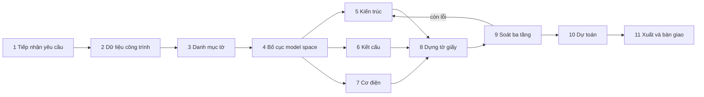

# vn-autocad-skill

[](https://github.com/andyluu98/vn-autocad-skill/actions/workflows/kiem-thu.yml)

Bộ **skill, agent và lệnh cho Claude Code** để dựng hồ sơ bản vẽ thiết kế thi công nhà ở chuẩn
Việt Nam (TCVN) **từ đầu đến cuối**: kiến trúc, kết cấu, cơ điện, soát lỗi tự động, xuất DWG qua
AutoCAD, và dự toán Excel lấy khối lượng từ chính bản vẽ. Kèm thư viện Python `vncad` và một bộ
hồ sơ mẫu 26 tờ chạy được ngay.

Nói gọn: bạn mô tả căn nhà, Claude hỏi lại những thông số còn thiếu, rồi dựng ra một bộ hồ sơ
có khung tên, kích thước, ký hiệu, bảng thống kê thép như hồ sơ thật, tự soát lỗi trước khi giao.

| | | |
|---|---|---|
|  |  |  |
| KT-01 Mặt bằng tầng 1, tầng 2 | KT-03 Mặt cắt A-A, mặt đứng | KT-05 Cầu thang, lan can 1/10 |
|  |  |  |
| KC-01 Móng, giằng, thống kê thép móng | KC-05 Kết cấu cầu thang | ME-05 Sơ đồ tủ điện |

## Dành cho ai

| Bạn là | Bộ này giúp gì |
|---|---|
| **Kiến trúc sư, kỹ sư kết cấu, kỹ sư dự toán** ở công ty tư vấn thiết kế vừa và nhỏ, hoặc làm tự do, chuyên nhà ở riêng lẻ (nhà phố, nhà ống, biệt thự phố) | Dựng bộ hồ sơ thi công trong vài giờ thay vì vài tuần; dành thời gian cho phần cần chuyên môn: kiểm tra, tính toán, ký |
| **Đội triển khai hồ sơ, hoạ viên CAD** | Có sẵn khung chuẩn (21 lớp, cỡ chữ, tỷ lệ, khung tên 16 trường) và bộ soát lỗi tự động thay cho việc dò bằng mắt |
| **Kỹ sư tự động hoá CAD/BIM, lập trình viên** | Thư viện Python quy chuẩn TCVN, API rõ ràng, có kiểm thử và CI |
| **Sinh viên kiến trúc, xây dựng** | Xem một bộ hồ sơ hoàn chỉnh gồm những tờ nào, trình bày ra sao, ghi chú viết thế nào |

### Không dành cho

- **Thay tính toán kết cấu.** Thư viện dựng bản vẽ và thống kê thép theo cấu tạo, không tính nội lực.
- **Thay chữ ký.** Hồ sơ xin phép và thi công phải do cá nhân có chứng chỉ hành nghề phù hợp chủ trì,
  kiểm tra và ký theo quy định pháp luật xây dựng hiện hành. Mọi thông số skill tự đề xuất đều được
  liệt kê riêng với nhãn "cần kỹ sư duyệt".
- **Công trình ngoài nhà ở riêng lẻ** (cao tầng, công nghiệp): thư viện dùng được, nhưng quy chuẩn
  và bộ mẫu trong skill viết cho nhà ở.

## Ra được gì

- **Một file DXF chứa cả bộ**, mỗi tờ là một Layout A3 có khung tên, đúng cách hồ sơ thật tổ chức.
  Mở thẳng trong AutoCAD và mọi phần mềm CAD.
- **DWG** qua AutoCAD MCP (tuỳ chọn), **PNG** từng tờ, **PDF**.
- **Dự toán Excel** 100% Times New Roman, công thức động, thép lấy từ bảng thống kê trên bản vẽ.

Bộ mẫu nhà phố 5x18m, 3 tầng gồm **15 tờ kiến trúc, 5 tờ kết cấu, 6 tờ cơ điện**. Danh mục đủ 26 tờ:
[skills/vn-quy-trinh-ho-so/references/danh-muc-ho-so-ban-ve.md](skills/vn-quy-trinh-ho-so/references/danh-muc-ho-so-ban-ve.md).

## Cài đặt

### Làm plugin Claude Code (khuyên dùng)

Trong Claude Code:

```
/plugin marketplace add andyluu98/vn-autocad-skill
/plugin install vn-autocad-skill@vn-autocad
```

Sau đó bảo Claude "cài thư viện cho plugin vn-autocad-skill"; skill sẽ chạy
`pip install -e "${CLAUDE_PLUGIN_ROOT}"`. Cập nhật: `/plugin marketplace update`.

### Dùng như thư viện Python

```bash
git clone https://github.com/andyluu98/vn-autocad-skill
cd vn-autocad-skill
pip install -e ".[test]"
python -m examples.nha_pho_5x18m.build_ho_so      # dung ca bo 26 to vao examples/out
```

**Yêu cầu:** Python 3.10 trở lên; `ezdxf`, `matplotlib`, `openpyxl` (tự cài theo);
phông **Times New Roman** (Windows có sẵn; Linux cài gói `ttf-mscorefonts-installer`), vì bộ soát
đo bề rộng chữ trên chính phông này.

### AutoCAD (tuỳ chọn)

Chỉ cần khi muốn file DWG: AutoCAD bản đầy đủ trên Windows và một AutoCAD MCP server có thao tác
chạy AutoLISP. Không có AutoCAD thì dùng file DXF. Chi tiết: skill `vn-xuat-autocad`.

## Bắt đầu nhanh

Trong Claude Code:

```
/ho-so-moi nhà phố 4x16m, 3 tầng, 3 phòng ngủ, có gara ô tô
```

(Nếu trùng tên với lệnh khác, gọi đủ tên: `/vn-autocad-skill:ho-so-moi ...`.)
Claude sẽ hỏi lại địa chất, chiều cao tầng, công năng từng tầng, kèm phương án để chọn, rồi đi
lần lượt 11 bước bên dưới. Hoặc cứ nói tự nhiên: "làm bộ bản vẽ thi công cho căn nhà này".

## Quy trình 11 bước



Mỗi bước có **cửa soát**: chưa đạt thì không sang bước sau. Bước 9 soát ba tầng: bốn phép tự động,
nhìn ảnh render, soát kỹ thuật (thép đúng lớp, số thanh khớp bước, hàm lượng thép hợp lý).
Chi tiết: [skills/vn-quy-trinh-ho-so/references/quy-trinh-chi-tiet.md](skills/vn-quy-trinh-ho-so/references/quy-trinh-chi-tiet.md).

## Thành phần

### Skill

| Skill | Phụ trách |
|---|---|
| `vn-quy-trinh-ho-so` | Điều phối 11 bước, cửa soát, chia việc, bàn giao |
| `vn-kien-truc` | Mặt bằng, mặt đứng, mặt cắt, khai triển, lát gạch, trần, chống thấm, tổng mặt bằng |
| `vn-ket-cau` | Móng, dầm sàn, chi tiết thép, cầu thang, bảng thống kê cốt thép sinh từ kích thước |
| `vn-co-dien` | Điện, nước từng tầng, sơ đồ nguyên lý, bảng ký hiệu |
| `vn-bo-cuc-to-giay` | Lưới ô model space, Layout A3, cửa sổ nhìn nhiều tỷ lệ |
| `vn-soat-ban-ve` | Bốn phép soát tự động, soát bằng mắt, soát kỹ thuật |
| `vn-du-toan` | Dự toán Excel lấy khối lượng từ bản vẽ |
| `vn-xuat-autocad` | DXF sang DWG qua AutoCAD MCP, PDF |

### Agent

| Agent | Vai |
|---|---|
| `kien-truc-su` | Triển khai phần kiến trúc |
| `ky-su-ket-cau` | Triển khai kết cấu và bảng thép |
| `ky-su-co-dien` | Triển khai các tờ ME |
| `kiem-soat-ban-ve` | Soát độc lập, chỉ đọc và báo lỗi kèm cách sửa |
| `ky-su-du-toan` | Lập dự toán gắn với bản vẽ |

Phiên chính của Claude điều phối theo skill `vn-quy-trinh-ho-so`; ba bộ môn vẽ song song được.

### Lệnh

| Lệnh | Làm gì |
|---|---|
| `/ho-so-moi <mô tả>` | Dựng bộ hồ sơ mới |
| `/soat-ban-ve [gói dự án]` | Soát đủ ba tầng |
| `/xuat-dwg <file.dxf>` | Chuyển sang DWG và đếm lại số tờ |

### Công cụ (`tools/`, dùng cho mọi dự án qua `--du-an`)

| Công cụ | Làm gì |
|---|---|
| `soat-ban-ve-khong-render.py` | Chạy bốn phép soát trong vài giây, không render ảnh |
| `chi-ra-net-cat-qua-chu.py` | Chỉ ra chính đoạn thẳng nào đang cắt qua một dòng chữ |
| `de-xuat-cho-dat-chu.py` | Đề xuất độ dời nhỏ nhất để chữ thôi bị cắt |
| `do-o-bao-cum-hinh.py` | Đo ô bao một cụm hình để đặt cửa sổ nhìn |

## Thư viện `vncad`

| Nhóm | Module |
|---|---|
| Quy chuẩn, tài liệu | `standards` (lớp, cỡ chữ, tỷ lệ, đo bề rộng chữ), `document`, `titleblock` |
| Kiến trúc | `arch`, `elevation`, `section`, `tiles`, `fixtures`, `blocks` |
| Kết cấu | `struct` (cấu kiện, bảng thống kê), `rebar` (chi tiết thép) |
| Cơ điện | `mep` |
| Ghi chú | `annotate` (kích thước 3 lớp, bong bóng trục, nhãn phòng, đánh số lớp) |
| Tờ giấy | `sheet`, `place`, `table` |
| Soát | `qc`, `qc_text`, `qc_geom` |
| Xuất | `render` (DXF, PNG, PDF), `estimate` (Excel), `acad` (AutoCAD) |
| Dự án | `project` (nạp dự án theo quy ước chung) |

Một dự án là một gói Python có `model.build_model`, `sheets.build_sheets` và
`regions.{CELL_W, CELL_H, O_LUOI}`. Dự án mới: chép `examples/nha_pho_5x18m` rồi sửa `layout.py`.

## Kiểm thử

```bash
pytest -q
```

22 bài kiểm, chạy khoảng 10 giây, CI trên Linux và Windows. Các bài kiểm chốt những lỗi thật đã gặp:
chữ xoay 90 độ tính sai ô bao, bảng thép sàn thiếu một phương, dự toán lệch bản vẽ, đường dẫn DWG
gạch ngược, cửa sổ nhìn lấn khung tên. Tổng thép của bộ mẫu được chốt bằng số đã soát tay.

## Bài học rút ra

25 lỗi thật gặp khi dựng bộ mẫu, kèm nguyên nhân và cách tránh:
[skills/vn-quy-trinh-ho-so/references/bai-hoc-thuc-chien.md](skills/vn-quy-trinh-ho-so/references/bai-hoc-thuc-chien.md).
Nên đọc trước khi bắt đầu dự án đầu tiên.

## Giới hạn đã biết

- Bộ soát chưa đọc chữ nằm trong đường kích thước và chữ, bảng biểu trên giấy; phải nhìn ảnh.
- Không in PDF qua AutoCAD MCP được; PDF xuất bằng `render.save_pdf`.
- Ký tự Ø hiển thị thành chấm tròn trong ảnh PNG (phông của bộ render); trong DXF, DWG vẫn đúng.
- Bộ mẫu: thông số giằng móng là đề xuất, chưa ghi chiều cao đài; khối lượng bê tông và ván
  khuôn móng trong dự toán mẫu vẫn là số gõ tay, lệch so với bản vẽ.

## Nguồn quy chuẩn

Lớp, cỡ chữ, tỷ lệ, ký hiệu, cách ghi thép, trường khung tên rút từ **34 bộ bản vẽ thi công thật
của 4 công trình ở Nam Bộ** (tên chủ đầu tư và địa điểm được lược bỏ). Cách bóc tách và số liệu:
[docs/phan-tich-ban-ve-thuc-te.md](docs/phan-tich-ban-ve-thuc-te.md).

Mọi tên người, tên đơn vị trong hồ sơ mẫu là tên mẫu.

## Giấy phép

[Apache License 2.0](LICENSE). Được dùng, sửa, phân phối, kể cả cho mục đích thương mại; khi phân
phối lại phải giữ thông báo bản quyền và ghi rõ những chỗ đã sửa.

## Nhật ký thay đổi

[CHANGELOG.md](CHANGELOG.md)
