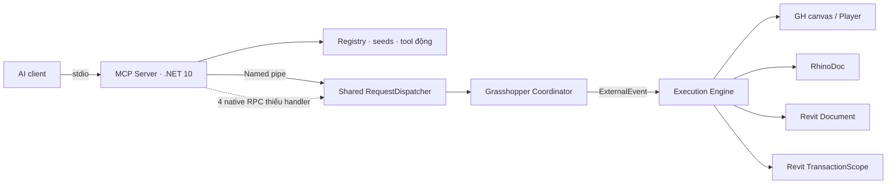

# HPGrasshopper MCP — bàn giao cho Antigravity

## 1. Nhiệm vụ và kết luận

**Nhiệm vụ:** sửa các lỗi đã xác định để AI có thể đọc, xây dựng, chạy, kiểm tra và chỉnh sửa chương trình Grasshopper theo yêu cầu người dùng. Ưu tiên tính đúng và khả năng phục hồi trước khi thêm chức năng.

**Kết luận kiểm toán:** kiến trúc phân lớp đạt một phần; chưa đủ tin cậy để nghiệm thu luồng end-to-end. Có lỗi routing của bốn native tool, rollback chưa bao phủ đúng tài nguyên, kết quả success chưa phản ánh sản phẩm thực và test mô phỏng chưa kiểm tra đủ đường production.

**Trạng thái tại thời điểm bàn giao:** source chỉ được đọc; đã build và chạy test an toàn; chưa sửa code, refactor, deploy, publish tool hoặc thay đổi model. Lệnh live `get_grasshopper_context` báo bridge chưa kết nối. Findings về code không đồng nghĩa đã tái hiện tác động native trên host thật.

Repository:

```text
G:\09-PROJECT AI\01_Revit\02_CshapRevit\01_AddinRebar
```

Đường dẫn source dưới đây là tương đối với repository root. Số dòng là dấu mốc của snapshot kiểm toán, cần tìm lại bằng tên class/method nếu source đã thay đổi.

### Chỉ dẫn làm việc cho Antigravity

1. Đọc tài liệu bắt buộc ở mục 2; kiểm tra working tree hiện tại và giữ nguyên thay đổi của người khác.
2. Đối chiếu lại findings với source hiện tại. Đánh dấu đã sửa nếu có thay đổi mới và có bằng chứng kiểm chứng; không sửa lặp lại.
3. Bắt đầu bằng bugfix nhóm A–C ở mục 8. Mỗi nhóm phải có regression test đi qua code production liên quan.
4. Tách bugfix, feature và refactor. Báo cáo này không phê duyệt refactor diện rộng, dependency mới hoặc toàn bộ feature backlog.
5. Giữ hướng phụ thuộc HPGrasshopper → McpShared; shared engine phải host-neutral, không tham chiếu Autodesk/Rhino/GH.
6. Khi đổi wire contract, dùng thay đổi additive và kiểm tra compatibility với server/bridge cũ. Khi chỉ sửa dispatch host, ưu tiên phạm vi HPGrasshopper nếu đáp ứng được yêu cầu.
7. Không chạy harness mặc định trên model đang làm việc. Kiểm tra live có ghi chỉ thực hiện trên tài liệu thử nghiệm đã được cho phép và có kiểm tra identity/path.
8. Ghi kết quả thật: Planned / Implemented / Built / Tested / Verified; passed mock, compilation và live phải báo riêng.
9. Không kết thúc bằng việc chỉ sửa descriptions hoặc làm test xanh: các đường production và đầu ra cần được nghiệm thu theo phạm vi triển khai.

## 2. Quy tắc bắt buộc

Đọc trước khi thiết kế hoặc sửa C#:

- `AGENTS.md` và instruction cục bộ nếu có.
- `docs/architecture/ARCHITECTURE.md`.
- `docs/clean-code/HP_CLEAN_CODE_CORE.md`.
- `docs/clean-code/host-appendix/revit.md`.
- `docs/clean-code/REVITADDINAI_CLEAN_CODE_STANDARD.md`.
- `docs/clean-code/TOOL_DEVELOPMENT_WORKFLOW.md`.
- `docs/clean-code/CODE_REVIEW_CHECKLIST.md`.

Áp dụng R1/R2/R4/R9 cho an toàn Revit khi phù hợp; không áp đặt feature-folder/composition policy riêng của HPRebar lên HPGrasshopper. Q-B1…Q-B3 là gate script; không thay thế kiểm tra hành vi. Tuân thủ P7 đối với package/project/manifest và P9 đối với wire contracts. Không coi ADR Proposed là quyết định đã được chấp nhận.

## 3. Môi trường và bằng chứng kiểm chứng

### 3.1. Phiên bản đã đọc

| Thành phần | Giá trị |
|---|---|
| Revit.exe | File version `26.5.0.55` |
| Rhino.exe / Grasshopper.dll | `8.26.25349.19001` |
| RhinoInside.Revit.dll | `1.35.9525.16240` |
| SDK thực tế | `10.0.400` |
| global.json | Pin `10.0.300`, `rollForward: latestMinor` |
| Bridge / bridge tests | `net10.0-windows7.0` |
| Server / server tests / E2E | `net10.0` |
| Configurations | `Debug`, `Release` |
| Pipe | `hpgrasshopper-mcp-2026` |

`C:\Program Files\Autodesk\Revit 2026\RevitNET.runtimeconfig.json` trên máy hiện tại khai báo `net10.0`, Microsoft.NETCore.App và Microsoft.WindowsDesktop.App `10.0.0`. Vì vậy không kết luận bridge .NET 10 chắc chắn không chạy trên máy này. Runtimeconfig trên disk chưa chứng minh CLR đang chạy hoặc compatibility trên máy khác.

### 3.2. Kết quả baseline

| Kiểm tra | Passed | Failed | Skipped | Giới hạn |
|---|---:|---:|---:|---|
| HPGrasshopper.Mcp.Server.Tests | 77 | 0 | 0 | Registry/schema/quality/seed compilation; không thực thi model thật |
| HPGrasshopper.E2E.Tests | 181 | 0 | 0 | Chủ yếu host mô phỏng, protocol và script harness |
| HPGrasshopper.McpBridge.Tests, có filter | 101 | 0 | 0 | Ngoài Revit, có stub/fakes; không chứng minh native transaction/undo |
| Build bridge/tests Debug | — | 0 | — | 0 warning, 0 error |
| tools/list trên server Debug, registry tạm | — | — | — | 27 tool trên registry sạch |
| get_grasshopper_context live | — | — | — | Bridge not connected |

**359 test passed. 13 test bị loại khỏi lần chạy, không phải skipped.** Toàn bộ lớp `FixtureDefinitionTests` bị loại vì static initialization ghi lại fixtures trong source/harness/definitions. Không chạy live harness hoặc `test_tool(realRun=true)` trong kiểm toán.

Baseline là kết quả đã quan sát trong phiên kiểm toán ngày 12/10/2026, không phải kết quả của code sau sửa. Không có log đầy đủ đính kèm trong file này; Antigravity phải lưu log kiểm chứng mới.

### 3.3. Lệnh đã dùng

Chạy từ `HPGrasshopper/`:

```powershell
dotnet test HPGrasshopper.Mcp.Server.Tests/HPGrasshopper.Mcp.Server.Tests.csproj -c Debug -p:DeployAddin=false
dotnet test HPGrasshopper.E2E.Tests/HPGrasshopper.E2E.Tests.csproj -c Debug -p:DeployAddin=false
dotnet build HPGrasshopper.McpBridge.Tests/HPGrasshopper.McpBridge.Tests.csproj -c Debug -p:DeployAddin=false

& './HPGrasshopper.McpBridge.Tests/bin/Debug/net10.0-windows7.0/HPGrasshopper.McpBridge.Tests.exe' `
  --filter-not-class HPGrasshopper.McpBridge.Tests.Fixtures.FixtureDefinitionTests `
  --no-progress --timeout 120s
```

Không dùng configuration `Debug.R26` cho HPGrasshopper. Không truyền `--nologo` cho MTP runner. Lần build ban đầu bị sandbox chặn đọc Windows SDK; đã chạy lại với quyền phù hợp và thành công, không phải lỗi source.

Khi kiểm tra `tools/list`, đặt `HPGRASSHOPPER_MCP_Registry__LibraryPath` và `HPGRASSHOPPER_MCP_Registry__DbPath` vào thư mục tạm riêng, `HPGRASSHOPPER_MCP_Registry__WatchLibrary=false`. Dùng Python UTF-8 nếu gọi `McpShared/tools/mcp-call.py` để tránh lỗi console encoding. Không dùng registry người dùng làm nơi thử nghiệm.

## 4. Kiến trúc và danh mục thực tế



Điểm nên giữ: tách process server/bridge; project references theo HPGrasshopper → McpShared; host assemblies không copy vào bin; opt-in; một execution đang chạy; correlated cancellation; script guard; Revit auto-transaction và failure preprocessor. Chưa có căn cứ viết lại toàn bộ kiến trúc.

### 4.1. Bảy tool lõi

| Tool | Input chính của schema | Ghi chú |
|---|---|---|
| get_grasshopper_context | includeSelection | Context hiện có lỗi F7 |
| read_grasshopper_canvas | includeValues, selectedOnly, categoryFilter | Routing F1; values chỉ summary |
| batch_edit_grasshopper_canvas | componentsToAdd, componentsToRemove, wiresToConnect, wiresToDisconnect, dryRun | Chưa có mutation giá trị/position object hiện hữu |
| run_grasshopper_player | filePath, inputs, outputs, headless | Native schema không có dryRun; không tự thêm giả định này |
| execute_grasshopper_code | code, transaction, dryRun, timeoutSeconds, label, args | Cooperative timeout 5–600; F2/F3 |
| export_grasshopper_canvas_image | mode, zoom, outputPath, returnBase64 | Routing F1; mode implementation F13 |
| cancel_execution | Không có input | F5 |

### 4.2. Registry

Tám tool: `search_tools`, `get_tool`, `run_tool`, `get_run`, `propose_tool`, `test_tool`, `publish_tool`, `manage_tool`.

Tool động đã publish được registrar expose riêng. 27 là baseline registry sạch: 7 core + 8 registry + 12 seeds. `inspect_type` bị profile chủ động suppress. Registry tool search không phải component/plugin catalog search.

### 4.3. Mười hai seed

| Seed | Mode | Implementation thực tế tại baseline |
|---|---|---|
| create_levels_grids | auto | Tạo Level/Grid mới, chưa reconcile |
| generate_columns_beams | auto | Tạo mới; chọn FamilySymbol đầu tiên và level mặc định |
| create_floors_slabs | auto | Tạo Floor; input structural chưa dùng |
| generate_rebar_curves | auto | Tạo rebar, bar type đầu tiên, normal Z |
| generate_stirrup_distribution | auto | Tính counts/vùng, chưa tạo reinforcement |
| facade_panelization | auto | Tọa độ lưới phẳng/corners, chưa tạo adaptive panel |
| curtain_grid_layout | auto | U offsets, chưa AddGridLine |
| create_wall_openings | auto | NewOpening trên tường |
| directshape_from_geometry | auto | Box extrusion, chưa nhận geometry Brep/Mesh tùy ý |
| query_revit_geometry | none | Summary hình học, chưa chuyển geometry vào GH |
| evaluate_solar_radiation | none | Cosine incident radiation; chưa shadow/annual analysis |
| export_model_to_rhino | none | Layer metadata/count ước tính; chưa xuất geometry/.3dm |

Seed schema có object/type/required và additionalProperties=false, nhưng chưa có các ràng buộc miền như min/max/item limits/enum. Cần bổ sung ràng buộc phù hợp từng input, không áp đặt cùng một giới hạn tùy ý cho mọi seed.

## 5. Findings và yêu cầu sửa

Các finding đã qua đối chiếu source và phản biện lại các đường handler/rollback. Không có finding P0 đủ căn cứ. Mức độ dưới đây là ưu tiên khắc phục; khác với việc đã có reproduction live.

### F1 — P1 — Bốn RPC native bị đứt đường production

- **Bằng chứng:** `HPGrasshopper/HPGrasshopper.Mcp.Server/Tools/ReadGrasshopperCanvasTool.cs:49`, `RunGrasshopperPlayerTool.cs:52`, `BatchEditGrasshopperCanvasTool.cs:55`, `ExportGrasshopperCanvasImageTool.cs:51` gọi `client.Profile.Method(ToolName)`.
- `McpShared/HPRebar.Mcp.Server.Core/Hosts/HostProfile.cs:161` chỉ ghép prefix/suffix. `McpShared/HPRebar.McpBridge.Core/Pipe/RequestDispatcher.cs:159` trả MethodNotFound sau custom handler.
- `HPGrasshopper/HPGrasshopper.McpBridge/Host/GrasshopperAddinApplication.cs:212–230` chỉ xử lý show_window. Các nhánh của ExecutionEngine xử lý **ExecuteRequest.Label**, không phải native RPC suffix.
- **Trigger/impact:** gọi public read/player/batch/image → không vào implementation tương ứng. Execute+label là đường khác, không chứng minh public native tools hoạt động.
- **Rule:** T4; giữ compatibility P9 khi sửa hợp đồng.
- **Sửa:** thống nhất native routing, request serialization, opt-in/busy/cancel/error handling. Không nối custom write handler theo cách bỏ qua opt-in.
- **Nghiệm thu:** mỗi tool đi từ public server method qua production dispatcher đến đúng handler; unknown method vẫn -32601; write khi opt-in=false bị từ chối; đọc được phép theo policy rõ ràng; test không dùng custom fake handler thay đường production.

### F2 — P1 — dryRun script chưa rollback GH/Rhino; Player có boundary riêng

- **Bằng chứng:** `Execution/GrasshopperExecutionEngine.cs:164–179` chỉ bọc RevitTransactionScope và cấp GH/Rhino objects mutable thật. CanvasUndoScope chỉ dùng trong CanvasEditor.
- `Tools/ExecuteGrasshopperCodeTool.cs:28` hứa rollback Revit và GH. `Execution/GrasshopperExecutionEngine.cs:86–99` chạy Player trực tiếp, không qua Revit scope, không truyền request.DryRun/token/timeout vào PlayerRunner.
- **Trigger/impact:** script sửa `doc`/`rhinoDoc` rồi dryRun/throw/cancel có thể giữ thay đổi GH/Rhino dù RolledBack=true. Native Player không có dryRun trong schema hiện tại; không tuyên bố khả năng chưa được expose.
- **Rule:** R2, T4.
- **Sửa:** xác định tài nguyên được phép mutation và boundary phục hồi thực tế; snapshot/undo đúng API hoặc từ chối mutation chưa hỗ trợ. Không báo rollback toàn bộ khi chỉ restore Revit. Đánh giá Player solve có side effects riêng.
- **Nghiệm thu:** so sánh graph, persistent params, wires, Rhino objects và Revit elements trước/sau success dryRun, exception và cancellation; có rollback status theo tài nguyên; các trường hợp unsupported bị từ chối trước khi ghi.

### F3 — P1 — transaction=none chưa enforce read-only

- **Bằng chứng:** `Execution/RevitTransactionScope.cs:215,231,255–259`; `Execution/RevitTransactionContext.cs:50–52`. Mode none không có group; RollbackGroup không có group là no-op nhưng dryRun vẫn trả true.
- Đường execute chỉ guard/compile, không enforce analyzer transaction facts. Guard Grasshopper không chặn Transaction Start/Commit theo mode.
- **Trigger/impact:** writable document; script tự mở/commit Revit Transaction dưới none có thể ghi thật, kể cả dryRun.
- **Rule:** R2, T4.
- **Sửa:** policy phải enforce ở execute, không chỉ propose/analyze. Không coi none là an toàn vì không mở auto transaction.
- **Nghiệm thu:** script tự mở Transaction trong none bị từ chối trước mutation hoặc được cơ chế bảo vệ kiểm chứng; tuyệt đối không trả RolledBack=true sau write không được restore.

### F4 — P1 — Batch atomicity, native undo và rollback result chưa đúng

- **Bằng chứng:** `Tools/CanvasEditor.cs:44–45` Commit trước NewSolution; catch gọi rollback sau khi scope completed. `Execution/CanvasUndoScope.cs:27–30` push record không AddAction; tracking chỉ vào Lists; `:78,142,156` catch restore errors; ArchiveBytes chưa được dùng restore.
- **Trigger/impact:** solve throw sau commit → graph vẫn sửa nhưng báo rolledBack=true. Native Ctrl+Z sau commit chưa được backing bởi undo actions. Compensation có tồn tại nhưng có thể partial.
- **Rule:** T4, PCC-290.
- **Sửa:** boundary complete sau các bước cần atomicity; native undo actions hoặc snapshot restore đúng API; trả trạng thái restore thật, không nuốt failure thành success.
- **Nghiệm thu:** Ctrl+Z/Redo phục hồi state đúng; fail-injected restore phải báo partial/error; solve exception không để graph thay đổi mà báo rollback thành công. Kiểm tra cả tác động solve lên Revit/Rhino.

### F5 — P1 — Queued cancellation/Raise failure có thể giữ busy

- **Bằng chứng:** `Coordinator/GrasshopperBridgeCoordinator.cs:172–184` bỏ kết quả Raise và chờ Completion.Task; chỉ kiểm cancelled khi Execute dequeue tại `:195`. Timeout Roslyn bắt đầu trong callback ở `Execution/RevitTransactionScope.cs:107`.
- **Trigger/impact:** modal/denied event/host không tick; cancel accepted nhưng queue không hoàn tất và busy không reset.
- **Rule:** R9, PCC-078.
- **Sửa:** kiểm Raise; lifecycle Queued/Running/Completed với hoàn tất đúng một lần; deadline/cancel queued work mà không cần callback; callback bỏ qua item đã kết thúc; dispose fail pending.
- **Nghiệm thu:** denied/null raiser, không có tick, queued cancel, disconnect và shutdown đều hoàn tất trong deadline; không chạy mutation sau khi đã cancelled; test không gọi Execute để cứu queued cancel.

### F6 — P1 — Chưa chốt identity của tài liệu/definition

- **Bằng chứng:** `Coordinator/McpBridgeWorkRequest.cs:14–17` chỉ Name/Work/Token; engine lấy active Revit/GH/Rhino khi callback thực thi.
- **Trigger/impact:** AI đọc A, người dùng chuyển sang B khi request queued → có thể chạy trên B.
- **Rule:** R4, P9 nếu thêm contract.
- **Sửa:** expected Revit document/GH definition identity và revision khi cần; recheck trong UI callback; không dùng Title làm identity duy nhất.
- **Nghiệm thu:** đổi document/definition giữa enqueue và callback phải bị từ chối; đóng/reopen file cùng tên không vượt identity check.

### F7 — P2 — Context và compiler readiness cần sửa

- **Bằng chứng context:** `Coordinator/GrasshopperBridgeCoordinator.cs:258` gọi Extract(null); `Coordinator/GrasshopperContextExtractor.cs:36–42` mặc định readonly=false, m, selection=[]; enumerate GH tại `:126` trên đường pipe thread.
- **Impact:** AI nhận context Revit sai/thiếu; snapshot GH có thể không nhất quán với UI.
- **Bằng chứng readiness có điều kiện:** coordinator cache compiler; `GrasshopperCompilerReferences.cs:126–150` bỏ assemblies chưa load. Cần reproduction lifecycle trước khi kết luận lỗi xảy ra trên mọi máy.
- **Rule:** R1, T4.
- **Sửa:** snapshot context đúng thread với UIApplication thực; Rhino units/tolerance; compiler chỉ init khi references sẵn sàng hoặc invalidate khi lifecycle thay đổi.
- **Nghiệm thu:** includeSelection/read-only/family/units đúng; query trong lúc sửa canvas không fabricate readiness; analyze trước khi Rhino load rồi execute sau khi load được kiểm chứng.

### F8 — P1 — Seed contract tạo/xuất sản phẩm nhưng code chỉ tính metadata

- **Bằng chứng:** `Registry/SeedLibrary/Geometry/facade_panelization/tool.json:22–23` so với `code.cs:39`; `Geometry/curtain_grid_layout/code.cs:46`; `Revit/generate_stirrup_distribution/code.cs:42`; `Generic/export_model_to_rhino/code.cs:48,61,67` cộng fixed 5/10 rồi success.
- **Impact:** AI có thể báo hoàn tất panel/grid/rebar/export dù chưa tạo đầu ra được hứa.
- **Rule:** P8, T4.
- **Sửa bug contract:** mô tả rõ calculate/plan/metadata nếu đó là khả năng hiện hữu; output khai báo phạm vi và actual changes. Không chỉ đổi tên success rồi vẫn nói đã tạo sản phẩm.
- **Feature riêng:** tạo adaptive panels/grid/stirrups hoặc xuất .3dm khi có yêu cầu và kế hoạch cụ thể.
- **Nghiệm thu:** output nêu số đối tượng thực hoặc artifact thực đã tạo; không fabricated export count; test assertions trên model/file, không chỉ JSON success.

### F9 — P1/P2 — Đầu vào quan trọng không quyết định sản phẩm

- **Bằng chứng:** `Revit/generate_rebar_curves/code.cs:3,17,24` đọc barDiameterMm nhưng lấy bar type đầu tiên, normal Z; `Revit/create_floors_slabs/code.cs:3,56` đọc structural nhưng không áp dụng; `Geometry/directshape_from_geometry/code.cs:1,37` shapeType không đổi box extrusion.
- **Impact:** đường kính, structural flag hoặc loại geometry khác yêu cầu mà vẫn success.
- **Rule:** M8, T4.
- **Sửa:** resolve đúng bar type/family/geometry theo input, hoặc reject unsupported input; normal từ plane hợp lệ; kiểm units ở boundary.
- **Nghiệm thu:** ít nhất hai diameter/types khác nhau cho kết quả khác đúng yêu cầu; plane ngoài XY; structural true/false; unsupported shape không âm thầm tạo box.

### F10 — P2 — Batch bỏ qua operation thất bại và thiếu parameter editing

- **Bằng chứng:** `Tools/CanvasEditor.cs:73` unknown component → continue; `:143–146` invalid wire không báo lỗi; `:167–168` disconnect port 0; `BatchEditGrasshopperCanvasTool.cs:19` hứa parameter/position edits nhưng signature không expose.
- **Rule:** M8, T4.
- **Sửa bug:** preflight từng operation, port indices và plugin/type availability; báo operation index + reason; output tempId→InstanceGuid. Disconnect đúng port.
- **Feature trong tool hiện có:** persistent values/slider range/position của object hiện hữu; typed tree payload nếu được chọn triển khai.
- **Nghiệm thu:** mixed valid/invalid batch không báo complete success; atomic policy rõ; không có partial edit nếu đã cam kết atomic; wire multi-port và missing plugin được kiểm tra.

### F11 — P2 — Player/reader mất kiểu, tree và chưa xác nhận solve

- **Bằng chứng:** `Tools/PlayerRunner.cs:160–176` chỉ number/bool/string; unmatched input bị bỏ; `:201,211` NickName key overwrite; `:223–225` flatten AllData + ToString; `:42–48` NewSolution rồi success không runtime-error/required-output check.
- `Tools/CanvasReader.cs:123–137` includeValues chỉ item count; inputs không lấy values; standalone param messages rỗng. `Execution/GrasshopperExecutionEngine.cs:137–140` bọc native result mà không map success=false thành ExecuteResult.IsError.
- **Rule:** M8, T4.
- **Sửa:** GUID identity, typed bounded values/branches/GH_Path, applied/rejected inputs; node-scoped severity diagnostics; phân biệt transport success, solve completion, graph validity và acceptance.
- **Nghiệm thu:** points/element refs nếu contract hứa; nhiều branch giữ path/type; output trùng NickName không ghi đè; missing output hoặc runtime Error không pass; kiểm input thực sự còn hiệu lực sau solve, không chỉ AddVolatileData được gọi.

### F12 — P2 — Test mock không chứng minh production workload

- **Bằng chứng:** `HPGrasshopper.E2E.Tests/Harness/GrasshopperTestExecutor.cs:79–89` counter/delay/synthetic element, không chạy Revit workload; `GrasshopperE2EHarness.cs:136–137` hardcoded 95/4500; `:180` mock PNG signature 10 bytes.
- `HPGrasshopper.McpBridge.Tests/TestInitializer.cs:81` tạo RevitAPIUI stub. `tools/PlayerRunnerTests.cs:232–275` có catch native load exceptions và missing-file paths không assertions đầy đủ.
- `Fixtures/FixtureDefinitionTests.cs:10,20,31–50` ghi lại fixture trong source khi chạy. Seed empirical tests có công thức tự tính trong test, không phải thực thi embedded seed.
- **Rule:** T1, T4.
- **Sửa:** giữ tests mô phỏng hữu ích nhưng gọi đúng tên/phạm vi; fixture generation explicit ở temp; unavailable native phải skip rõ; bổ sung production-path và live output checks. Không xóa assertions chỉ để tăng pass count.
- **Nghiệm thu:** F1–F11 có regression test thất bại trên baseline tương ứng; phân loại mock/metadata/native/live; fixtures source không đổi sau test; skipped không tính verified.

### F13 — P3 — Export/headless options không đầy đủ

- **Bằng chứng:** `Tools/ImageExporter.cs:27,38,52–58` mode chỉ echo, DrawToBitmap viewport, zoom clamp .25–4 khác description .1–5; `Tools/PlayerRunner.cs:85–87` headless=false chỉ không dispose, chưa quản lý document trên canvas/DocumentServer.
- **Rule:** T4.
- **Sửa:** thực hiện option đúng hoặc thu hẹp contract; ownership/disposal rõ cho background/visible document.
- **Nghiệm thu:** FullCanvas thấy node ngoài viewport; Selection đúng bounds; PNG decode được; visible document có owner và đóng được, không leak.

## 6. Năng lực cần nâng cấp, không gộp thành bugfix

| Năng lực | Thiếu hiện tại | Hướng ưu tiên |
|---|---|---|
| Component/plugin discovery | Chỉ đọc objects đã đặt; AI phải biết GUID/API | Mở rộng inspection hiện có: catalog, GUID, plugin/version, port/access/type signatures |
| Data Tree/list matching | Chưa typed tree roundtrip, access/mapping đủ | Mở rộng read/player/batch; GH_Path, nulls, flatten/graft/simplify rõ |
| Script component authoring | Raw Roslyn execute không đồng nghĩa chỉnh C#/Python component | Capability có version-specific diagnostics và dynamic ports |
| Save/open definition | Player load tạm, chưa workflow save/new/open verified | Lifecycle và archive workflow trong phạm vi tool hiện có nếu phù hợp |
| Revit synchronization | Create mới mỗi lần; DirectShape ApplicationDataId ngẫu nhiên | Stable owner/key + create/update reconciliation, explicit deletion policy |
| Acceptance theo người dùng | Success chưa khẳng định kết quả domain | Expected metrics/assertions và output chứng minh từng yêu cầu |
| Graph lớn | Chưa đủ bounded inspection/tree samples | Đặt paging/output budgets sau đo đạc; không thêm giới hạn tùy ý |

Ví dụ rerun duplicate: `Registry/SeedLibrary/Geometry/directshape_from_geometry/code.cs:18–20` luôn CreateElement và Guid.NewGuid. Đây là thiếu năng lực update/reconcile, không phải vi phạm annotation idempotent đã hứa.

## 7. Ba kịch bản nghiệm thu thật

Các kịch bản sau **CHƯA CHẠY LIVE**. Chỉ dùng tài liệu thử nghiệm đã được cho phép; không sửa model đang làm việc. Ghi version, fixture path/hash, expected units, trước/sau và run IDs vào report mới.

| Kịch bản | Input/giả định | Tiêu chí đạt |
|---|---|---|
| S1 — geometry tham số | Rhino mm; circle R=1000; sửa R=1500 | Radius/area đúng trong tolerance; không runtime Error; typed output; save/reopen giữ graph và giá trị |
| S2 — Data Tree | `{0}=[1,2]`, `{1}=[3]`; nhân 10 | `{0}=[10,20]`, `{1}=[30]`; paths/type/order giữ đúng; duplicate NickName không mất output |
| S3 — Revit create/update | Box 1000×2000×3000 mm; đổi width=1500 | Volume 6→9 m³; một element với identity ổn định; dryRun/throw/cancel không đổi Revit/GH/Rhino state |

S3 cần feature reconciliation; không dùng việc chưa đạt S3 để bắt buộc thêm feature vào commit bugfix. Sau bugfix phải nghiệm thu riêng routing, error/rollback, types và inputs hiện đã cam kết.

## 8. Thứ tự thực hiện và tiêu chí hoàn tất

| Nhóm | Loại | Finding/phạm vi | Độ phức tạp | Phụ thuộc | Gate |
|---|---|---|---|---|---|
| A | Bugfix | F1, mapping errors của F11; schema/skill drift | Vừa | Không | Public tools đi qua production dispatcher; read/write policy đúng |
| B | Bugfix | F2–F7, F4 undo/atomicity | Cao | A cho native integration | State trước/sau đúng; cancelled queue hoàn tất không cần host tick; document mismatch refused |
| C | Bugfix | F8–F10, F11 promised I/O | Vừa–cao | A/B khi có mutations | Input thực sự chi phối sản phẩm; contract trung thực; solve errors không success |
| D | Validation | F12, regression + fixture isolation | Vừa | Viết cùng A–C | Tests cover production code; nguồn fixture không đổi; baseline/retest rõ |
| E | Feature | Discovery/tree/authoring/save/update | Cao | A–D | Scope/spec riêng; S1–S3 theo feature được chọn |
| F | Optional polish | F13, bounded inspection cải tiến thêm | Vừa | A/B | Option đúng contract và lifecycle không leak |

### Checklist để Antigravity cập nhật

- [ ] Revalidate findings theo source hiện tại, không ghi đè work khác.
- [ ] Hoàn tất routing A và regression tests.
- [ ] Hoàn tất boundaries/queue/identity B với state assertions.
- [ ] Hoàn tất các contract/input defects C trong phạm vi đã chọn.
- [ ] Làm tests/fixtures D độc lập và phân loại bằng chứng.
- [ ] Build Debug và configuration Release khi nằm trong phạm vi deliverable, không deploy tự động.
- [ ] Chạy server/bridge/E2E suites phù hợp; báo passed/failed/skipped/excluded riêng.
- [ ] Nếu McpShared đổi: chạy tests shared liên quan và compatibility surface/giao thức; không chỉ tests Grasshopper.
- [ ] Q-B1…Q-B3 và checklist clean-code pass cho code/seed đã thay đổi.
- [ ] Live trên fixture được cho phép hoặc ghi CHƯA TEST + lý do; không gán Verified cho mock.
- [ ] Diff không chứa refactor/features không liên quan; docs/schema/examples/skill khớp khả năng thực tế.
- [ ] Báo cáo cuối mapping mỗi F-id → sửa ở đâu → lệnh/test/bằng chứng → còn giới hạn gì.

## 9. Điều chưa xác minh và lưu ý harness

- Chưa có bridge live trong phiên kiểm toán; chưa chứng minh production add-in load, Ctrl+Z, native solver, geometry hay writes đúng.
- Chưa kiểm tra các máy Revit 2026 có runtimeconfig khác; không sửa runtimeconfig host để ép bridge load trong phạm vi bugfix.
- Chưa có bài toán thực tế cụ thể của người dùng; S1–S3 là acceptance mẫu, không bảo đảm mọi chương trình.
- `HPGrasshopper/tools/harness/run-live-verify.ps1` có thể chọn live khi thấy production pipe; `live-verify.py` có Player/publish thao tác. Không chạy nguyên harness chỉ vì tên “verify”. Mock harness cũng cần pipe/registry riêng để tránh đụng live session.
- Skill hướng dẫn Grasshopper có count/schema/registry names khác runtime; cập nhật theo source/runtime cuối cùng khi sửa, không sao chép catalog cũ.

## 10. Tài liệu API đối chiếu

- [McNeel — GH_UndoRecord.AddAction](https://developer.rhino3d.com/api/grasshopper/html/M_Grasshopper_Kernel_Undo_GH_UndoRecord_AddAction.htm).
- [McNeel — GH_UndoServer methods](https://developer.rhino3d.com/api/grasshopper/html/Methods_T_Grasshopper_Kernel_Undo_GH_UndoServer.htm).
- [McNeel — IGH_Param methods](https://developer.rhino3d.com/api/grasshopper/html/Methods_T_Grasshopper_Kernel_IGH_Param.htm).

API online có thể hiển thị bản Rhino mới hơn máy đang kiểm tra. Đối chiếu thêm XML/assemblies Rhino 8.26 đã cài và native fixture; không coi trang docs bản mới là bằng chứng compatibility trực tiếp.
